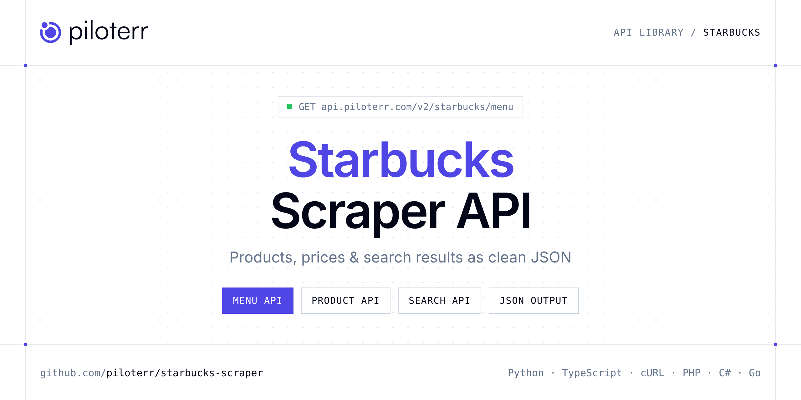

<p align="center">
  <a href="https://www.piloterr.com"></a>
</p>

# Starbucks Scraper API

[](https://discord.gg/CFj3ph8aHU) [](https://app.piloterr.com) [](https://app.piloterr.com/openapi) [](LICENSE)

The **Piloterr Starbucks Scraper API** lets you extract public data from Starbucks as **clean, structured JSON** — no proxies, headless browsers or HTML parsing to maintain. Endpoints available in production:

- **Starbucks Menu API** — Full Starbucks menu for one café, with the default-size price of each item.
- **Starbucks Product API** — One Starbucks item at one café, with a price for every size.
- **Starbucks Search API** — Nearest Starbucks cafés from coordinates or a store-locator URL.

Use it for price monitoring, assortment tracking, competitor analysis, product research or catalog enrichment.

| Endpoint | Path | Credits | What you get |
|---|---|---|---|
| [Starbucks Menu API](#starbucks-menu-api) | `/v2/starbucks/menu` | 3 | Full Starbucks menu for one café, with the default-size price of each item. Prices use browser rendering. |
| [Starbucks Product API](#starbucks-product-api) | `/v2/starbucks/product` | 3 | One Starbucks item at one café, with a price for every size. Get the café from Search first. Prices use browser rendering. |
| [Starbucks Search API](#starbucks-search-api) | `/v2/starbucks/search` | 3 | Nearest Starbucks cafés from coordinates or a store-locator URL. Returns address, hours, amenities, and the store number used by Menu and Product. |

## Table of contents

- [How it works](#how-it-works)
- [Starbucks Menu API](#starbucks-menu-api)
- [Starbucks Product API](#starbucks-product-api)
- [Starbucks Search API](#starbucks-search-api)
- [Code examples in other languages](#code-examples-in-other-languages)
- [Practical use cases](#practical-use-cases)
- [Why Piloterr?](#why-piloterr)
- [FAQ](#faq)
- [Related scrapers](#related-scrapers)
- [Support](#support)

## How it works

1. **Create a free Piloterr account** and copy your API key from the [dashboard](https://app.piloterr.com).
2. **Send a `GET` (or `POST`) request** to `https://api.piloterr.com/v2/...` with the header `x-api-key: YOUR_API_KEY`.
3. **Receive structured JSON** — Piloterr handles rendering, proxies, retries and parsing.

```bash
export PILOTERR_API_KEY="your-api-key"
pip install requests        # Python
# TypeScript: Node.js 18+ (native fetch), run with `npx tsx file.ts`
```

> Every endpoint accepts both `GET` (query string) and `POST` (JSON body with the same fields).

## Starbucks Menu API

Full Starbucks menu for one café, with the default-size price of each item. Prices use browser rendering.

`GET | POST https://api.piloterr.com/v2/starbucks/menu` · **3 credits per request** · [Full reference](https://app.piloterr.com/openapi)

### Request parameters

| Parameter | Type | Required | Description |
|---|---|---|---|
| `store_number` | string | — | Café number from Search, short (`9230`) or full (`9230-154245`). |
| `query` | string | — | Same café number, or a menu URL that contains `storeNumber`. Used when `store_number` is empty. |

### Python example

```python
import json
import os
import requests

response = requests.get(
    "https://api.piloterr.com/v2/starbucks/menu",
    headers={"x-api-key": os.environ["PILOTERR_API_KEY"]},
    params={

    },
    timeout=60,
)
response.raise_for_status()
data = response.json()

print(json.dumps(data, indent=2, ensure_ascii=False)[:2000])
```

### TypeScript example

```typescript
type StarbucksMenu = {
  store?: {
    name?: string;
    open?: boolean;
    phone?: string;
    address?: {
      city?: string;
      line1?: string;
      region?: string;
      country?: string;
      formatted?: string;
      postal_code?: string;
    };
    distance?: unknown;
    schedule?: {
      day?: string;
      open?: boolean;
      hours?: string;
    }[];
    store_id?: string;
    amenities?: string[];
    time_zone?: string;
    coordinates?: {
      latitude?: number;
      longitude?: number;
    };
    open_status?: string;
    hours_status?: string;
    store_number?: string;
    ownership_type_code?: string;
    recommendation_reason?: string;
  };
  results?: {
    sku?: string;
    uri?: string;
    url?: string;
    name?: string;
    size?: string;
    price?: number;
    sizes?: string[];
    calories?: string;
    currency?: string;
    form_code?: string;
    image_url?: string;
    categories?: string[];
    availability?: string;
    product_type?: string;
    product_number?: number;
  }[];
  currency?: string;
  pagination?: {
    next?: unknown;
    page?: number;
    per_page?: number;
    total_pages?: number;
    total_results?: number;
  };
};

const params = new URLSearchParams({

});

const response = await fetch(`https://api.piloterr.com/v2/starbucks/menu?${params}`, {
  headers: { "x-api-key": process.env.PILOTERR_API_KEY! },
});
if (!response.ok) throw new Error(`Piloterr error ${response.status}: ${await response.text()}`);

const data = (await response.json()) as StarbucksMenu;

console.log(JSON.stringify(data, null, 2).slice(0, 2000));
```

<details>
<summary><b>POST variant</b></summary>

```http
POST https://api.piloterr.com/v2/starbucks/menu
x-api-key: YOUR_API_KEY
Content-Type: application/json

{}
```
</details>

### Output example

Example response from the API reference, abridged — real values depend on the page you scrape.

```json
{
  "store": {
    "name": "DTLA Grand Park",
    "open": false,
    "phone": "example",
    "address": {
      "city": "Los Angeles",
      "line1": "217 N. Hill Street",
      "region": "CA",
      "country": "US",
      "formatted": "217 N. Hill Street, Los Angeles",
      "postal_code": "90012"
    },
    "distance": null,
    "schedule": [
      {
        "day": "thursday",
        "open": true,
        "hours": "4:30 AM to 9:00 PM"
      },
      {
        "day": "friday",
        "open": true,
        "hours": "4:30 AM to 9:00 PM"
      }
    ],
    "store_id": "69543",
    "amenities": [
      "In café",
      "Mobile Order and Pay"
    ],
    "time_zone": "GMT-07:00 America/Los_Angeles",
    "coordinates": {
      "latitude": 34.05612,
      "longitude": -118.24698
    },
    "open_status": "Opens Thursday at 4:30 AM",
    "hours_status": "Open 4:30 AM-9:00 PM",
    "store_number": "9230-154245",
    "ownership_type_code": "co",
    "recommendation_reason": "nearby"
  },
  "results": [
    {
      "sku": "183887",
      "uri": "/product/418/hot",
      "url": "https://www.starbucks.com/menu/product/418/hot",
      "name": "Pumpkin Spice Latte",
      "size": "grande",
      "price": 6.75,
      "sizes": [
        "short",
        "tall"
      ],
      "calories": "390 calories",
      "currency": "usd",
      "form_code": "hot",
      "image_url": "https://cloudassets.starbucks.com/is/image/sbuxcorp/PumpkinSpiceLatteV1",
      "categories": [
        "The Latest > Pumpkin Picks",
        "Coffee & Espresso > Hot Coffee & Espresso > Latte"
      ],
      "availability": "purchasable",
      "product_type": "beverage",
      "product_number": 418
    }
  ],
  "currency": "usd",
  "pagination": {
    "next": null,
    "page": 1,
    "per_page": 275,
    "total_pages": 1,
    "total_results": 275
  }
}
```

### Response fields

| Field | Type | Description |
|---|---|---|
| `store` | object |  |
| `store.name` | string |  |
| `store.open` | boolean |  |
| `store.phone` | string |  |
| `store.address` | object |  |
| `store.distance` | object |  |
| `store.schedule[]` | object[] |  |
| `store.store_id` | string |  |
| `store.amenities` | string[] |  |
| `store.time_zone` | string |  |
| `store.coordinates` | object |  |
| `store.open_status` | string |  |
| `store.hours_status` | string |  |
| `store.store_number` | string |  |
| `store.ownership_type_code` | string |  |
| `store.recommendation_reason` | string |  |
| `results[]` | object[] |  |
| `results[].sku` | string |  |
| `results[].uri` | string |  |
| `results[].url` | string |  |
| `results[].name` | string |  |
| `results[].size` | string |  |
| `results[].price` | number |  |
| `results[].sizes` | string[] |  |
| `results[].calories` | string |  |

## Starbucks Product API

One Starbucks item at one café, with a price for every size. Get the café from Search first. Prices use browser rendering.

`GET | POST https://api.piloterr.com/v2/starbucks/product` · **3 credits per request** · [Full reference](https://app.piloterr.com/openapi)

### Request parameters

| Parameter | Type | Required | Description |
|---|---|---|---|
| `query` | string | ✅ | Product and form, or a Starbucks product URL. |
| `store_number` | string | — | Café number from Search, short (`9230`) or full (`9230-154245`). Required when the product URL has no `storeNumber`. |
| `form_code` | string | — | Form when `query` is only a product number. Usually `hot` or `iced`. |

### Python example

```python
import json
import os
import requests

response = requests.get(
    "https://api.piloterr.com/v2/starbucks/product",
    headers={"x-api-key": os.environ["PILOTERR_API_KEY"]},
    params={
        "query": "418/hot",
    },
    timeout=60,
)
response.raise_for_status()
data = response.json()

print(json.dumps(data, indent=2, ensure_ascii=False)[:2000])
```

### TypeScript example

```typescript
type StarbucksProduct = {
  url?: string;
  name?: string;
  sizes?: {
    sku?: string;
    name?: string;
    price?: number;
    default?: boolean;
    calories?: string;
    currency?: string;
    size_code?: string;
  }[];
  currency?: string;
  form_code?: string;
  image_url?: string;
  store_name?: string;
  description?: string;
  product_type?: string;
  store_number?: string;
  product_number?: number;
};

const params = new URLSearchParams({
  "query": "418/hot",
});

const response = await fetch(`https://api.piloterr.com/v2/starbucks/product?${params}`, {
  headers: { "x-api-key": process.env.PILOTERR_API_KEY! },
});
if (!response.ok) throw new Error(`Piloterr error ${response.status}: ${await response.text()}`);

const data = (await response.json()) as StarbucksProduct;

console.log(JSON.stringify(data, null, 2).slice(0, 2000));
```

<details>
<summary><b>POST variant</b></summary>

```http
POST https://api.piloterr.com/v2/starbucks/product
x-api-key: YOUR_API_KEY
Content-Type: application/json

{"query": "418/hot"}
```
</details>

### Output example

Example response from the API reference, abridged — real values depend on the page you scrape.

```json
{
  "url": "https://www.starbucks.com/menu/product/418/hot",
  "name": "Pumpkin Spice Latte",
  "sizes": [
    {
      "sku": "183885",
      "name": "short",
      "price": 6.15,
      "default": false,
      "calories": "210 calories",
      "currency": "usd",
      "size_code": "short"
    },
    {
      "sku": "183886",
      "name": "tall",
      "price": 6.25,
      "default": false,
      "calories": "300 calories",
      "currency": "usd",
      "size_code": "tall"
    }
  ],
  "currency": "usd",
  "form_code": "hot",
  "image_url": "https://cloudassets.starbucks.com/is/image/sbuxcorp/PumpkinSpiceLatteV1",
  "store_name": "DTLA Grand Park",
  "description": "Our signature Espresso Roast and steamed milk with the celebrated flavor combination of pumpkin, cinnamon, nutmeg and clove. Enjoy it top…",
  "product_type": "beverages",
  "store_number": "9230-154245",
  "product_number": 418
}
```

### Response fields

| Field | Type | Description |
|---|---|---|
| `url` | string |  |
| `name` | string |  |
| `sizes[]` | object[] |  |
| `sizes[].sku` | string |  |
| `sizes[].name` | string |  |
| `sizes[].price` | number |  |
| `sizes[].default` | boolean |  |
| `sizes[].calories` | string |  |
| `sizes[].currency` | string |  |
| `sizes[].size_code` | string |  |
| `currency` | string |  |
| `form_code` | string |  |
| `image_url` | string |  |
| `store_name` | string |  |
| `description` | string |  |
| `product_type` | string |  |
| `store_number` | string |  |
| `product_number` | integer |  |

## Starbucks Search API

Nearest Starbucks cafés from coordinates or a store-locator URL. Returns address, hours, amenities, and the store number used by Menu and Product.

`GET | POST https://api.piloterr.com/v2/starbucks/search` · **3 credits per request** · [Full reference](https://app.piloterr.com/openapi)

### Request parameters

| Parameter | Type | Required | Description |
|---|---|---|---|
| `query` | string | — | Store-locator URL, or a `lat,lng` pair. Required when `lat` and `lng` are empty. |
| `lat` | number | — | Latitude. Send it with `lng`. If both are set, they replace any coordinates found in `query`. |
| `lng` | number | — | Longitude. Send it with `lat`. |
| `place` | string | — | Optional place label sent with the coordinates, for example `New York, NY`. Coordinates are still required. |
| `features` | string | — | Optional amenity filter. Separate codes with commas. `ON` keeps cafés that offer mobile order. |

### Python example

```python
import json
import os
import requests

response = requests.get(
    "https://api.piloterr.com/v2/starbucks/search",
    headers={"x-api-key": os.environ["PILOTERR_API_KEY"]},
    params={
        "query": "https://www.starbucks.com/store-locator?map=40.71391,-74.01121,12z",
    },
    timeout=60,
)
response.raise_for_status()
data = response.json()

print(json.dumps(data, indent=2, ensure_ascii=False)[:2000])
```

### TypeScript example

```typescript
type StarbucksSearch = {
  results?: {
    name?: string;
    open?: boolean;
    phone?: string;
    address?: {
      city?: string;
      line1?: string;
      region?: string;
      country?: string;
      formatted?: string;
      postal_code?: string;
    };
    distance?: number;
    schedule?: {
      day?: string;
      open?: boolean;
      hours?: string;
    }[];
    store_id?: string;
    amenities?: string[];
    time_zone?: string;
    coordinates?: {
      latitude?: number;
      longitude?: number;
    };
    open_status?: string;
    hours_status?: string;
    store_number?: string;
    ownership_type_code?: string;
    recommendation_reason?: string;
  }[];
  pagination?: {
    next?: unknown;
    page?: number;
    per_page?: number;
    total_pages?: unknown;
    total_results?: unknown;
  };
};

const params = new URLSearchParams({
  "query": "https://www.starbucks.com/store-locator?map=40.71391,-74.01121,12z",
});

const response = await fetch(`https://api.piloterr.com/v2/starbucks/search?${params}`, {
  headers: { "x-api-key": process.env.PILOTERR_API_KEY! },
});
if (!response.ok) throw new Error(`Piloterr error ${response.status}: ${await response.text()}`);

const data = (await response.json()) as StarbucksSearch;

console.log(JSON.stringify(data, null, 2).slice(0, 2000));
```

<details>
<summary><b>POST variant</b></summary>

```http
POST https://api.piloterr.com/v2/starbucks/search
x-api-key: YOUR_API_KEY
Content-Type: application/json

{"query": "https://www.starbucks.com/store-locator?map=40.71391,-74.01121,12z"}
```
</details>

### Output example

Example response from the API reference, abridged — real values depend on the page you scrape.

```json
{
  "results": [
    {
      "name": "DTLA Grand Park",
      "open": false,
      "phone": "example",
      "address": {
        "city": "Los Angeles",
        "line1": "217 N. Hill Street",
        "region": "CA",
        "country": "US",
        "formatted": "217 N. Hill Street, Los Angeles",
        "postal_code": "90012"
      },
      "distance": 0.262,
      "schedule": [
        {},
        {}
      ],
      "store_id": "69543",
      "amenities": [
        "In café",
        "Mobile Order and Pay"
      ],
      "time_zone": "GMT-07:00 America/Los_Angeles",
      "coordinates": {
        "latitude": 34.05612,
        "longitude": -118.24698
      },
      "open_status": "Opens Thursday at 4:30 AM",
      "hours_status": "Open 4:30 AM-9:00 PM",
      "store_number": "9230-154245",
      "ownership_type_code": "co",
      "recommendation_reason": "nearby"
    }
  ],
  "pagination": {
    "next": null,
    "page": 1,
    "per_page": 50,
    "total_pages": null,
    "total_results": null
  }
}
```

### Response fields

| Field | Type | Description |
|---|---|---|
| `results[]` | object[] |  |
| `results[].name` | string |  |
| `results[].open` | boolean |  |
| `results[].phone` | string |  |
| `results[].address` | object |  |
| `results[].distance` | number |  |
| `results[].schedule[]` | object[] |  |
| `results[].store_id` | string |  |
| `results[].amenities` | string[] |  |
| `results[].time_zone` | string |  |
| `results[].coordinates` | object |  |
| `results[].open_status` | string |  |
| `results[].hours_status` | string |  |
| `results[].store_number` | string |  |
| `results[].ownership_type_code` | string |  |
| `results[].recommendation_reason` | string |  |
| `pagination` | object |  |
| `pagination.next` | object |  |
| `pagination.page` | integer |  |
| `pagination.per_page` | integer |  |
| `pagination.total_pages` | object |  |
| `pagination.total_results` | object |  |

## Code examples in other languages

Ready-to-run examples live in the [`examples/`](examples) folder. Each one reads your key from the `PILOTERR_API_KEY` environment variable.

| Language | Menu | Product | Search |
|---|---|---|---|
| cURL (Bash) | [`menu`](examples/curl/menu.sh) | [`product`](examples/curl/product.sh) | [`search`](examples/curl/search.sh) |
| PHP | [`menu`](examples/php/menu.php) | [`product`](examples/php/product.php) | [`search`](examples/php/search.php) |
| C# | [`menu`](examples/csharp/Menu.cs) | [`product`](examples/csharp/Product.cs) | [`search`](examples/csharp/Search.cs) |
| Go | [`menu`](examples/go/menu.go) | [`product`](examples/go/product.go) | [`search`](examples/go/search.go) |
| Java | [`menu`](examples/java/MenuExample.java) | [`product`](examples/java/ProductExample.java) | [`search`](examples/java/SearchExample.java) |
| Ruby | [`menu`](examples/ruby/menu.rb) | [`product`](examples/ruby/product.rb) | [`search`](examples/ruby/search.rb) |
| Node.js | [`menu`](examples/nodejs/menu.mjs) | [`product`](examples/nodejs/product.mjs) | [`search`](examples/nodejs/search.mjs) |

## Practical use cases

- **Price monitoring** — Track prices, promotions and availability over time to react to competitors.
- **Assortment & catalog tracking** — Follow new products, delisted items and category changes.
- **Competitor analysis** — Benchmark ranges, brands and positioning across retailers.
- **Product research** — Spot best-sellers and trends from search results.
- **Catalog enrichment** — Pull titles, images and attributes into your PIM or marketplace listings.

## Why Piloterr?

- **No infrastructure** — no proxies, headless browsers or CAPTCHA solving to run yourself.
- **Structured JSON** — stable, documented fields instead of brittle HTML selectors.
- **Pay per request** — transparent credit cost per endpoint, failed requests are retried for you.
- **One API key, hundreds of sources** — Starbucks plus many other e-commerce, search and company data endpoints in the [Piloterr library](https://www.piloterr.com/library).
- **Any language** — plain HTTPS + JSON, with examples for Python, TypeScript, cURL, PHP, C#, Go, Java, Ruby and Node.js.

## FAQ

### Is it legal to scrape Starbucks?

Collecting publicly available data is generally allowed in many jurisdictions, but rules depend on your country, the data you collect and how you use it. Avoid personal data unless you have a lawful basis, respect the website's terms where they apply, and get legal advice for your specific use case. This is not legal advice.

### Do I need proxies or a headless browser?

No. Piloterr handles rendering, proxy rotation and retries on its side. You only send an HTTPS request with your `x-api-key` header and receive JSON.

### How much does a request cost?

Credits per call: `/v2/starbucks/menu` **3**, `/v2/starbucks/product` **3**, `/v2/starbucks/search` **3**. See the [Piloterr website](https://www.piloterr.com) for plans.

### What data does the Starbucks API return?

Each endpoint returns structured JSON: **Starbucks Menu** — `store`, `store.name`, `store.open`, `store.phone`, `store.address`, `store.distance`; **Starbucks Product** — `url`, `name`, `sizes[]`, `sizes[].sku`, `sizes[].name`, `sizes[].price`; **Starbucks Search** — `results[]`, `results[].name`, `results[].open`, `results[].phone`, `results[].address`, `results[].distance`.

### Which languages are supported?

Any language that can make an HTTP request. This README shows Python and TypeScript; the [`examples/`](examples) folder contains cURL, PHP, C#, Go, Java, Ruby and Node.js.

## Related scrapers

- [About You Scraper API](https://github.com/piloterr/aboutyou-scraper)
- [Action Scraper API](https://github.com/piloterr/action-scraper)
- [Aldi Scraper API](https://github.com/piloterr/aldi-scraper)
- [Alibaba Scraper API](https://github.com/piloterr/alibaba-scraper)
- [AliExpress Scraper API](https://github.com/piloterr/aliexpress-scraper)
- [Allegro Scraper API](https://github.com/piloterr/allegro-scraper)
- [All Piloterr scrapers on GitHub](https://github.com/piloterr)

## Support

- 💬 Join the [Piloterr Discord](https://discord.gg/CFj3ph8aHU) to ask questions and share what you build.
- 📚 Browse the [API reference (OpenAPI)](https://app.piloterr.com/openapi) and the [Piloterr library](https://www.piloterr.com/library).
- 🔑 [Get your API key](https://app.piloterr.com).

---

<p align="center">
  <a href="https://www.piloterr.com">
    <picture>
      <source media="(prefers-color-scheme: dark)" srcset="images/logo-dark.svg">
      
    </picture>
  </a>
  <br>
  <sub>Built by <a href="https://www.piloterr.com">Piloterr</a> — web scraping APIs for e-commerce, search, real estate and more, one API key.</sub>
</p>

<sub>Starbucks is a trademark of its respective owner. This repository is not affiliated with or endorsed by Starbucks. Examples are released under the MIT license.</sub>
